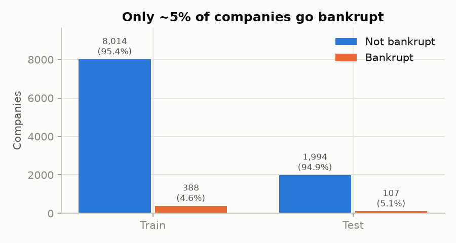
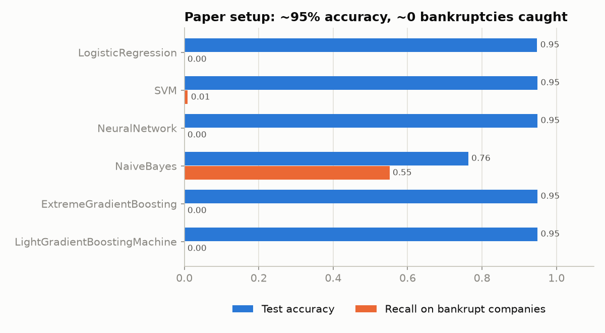
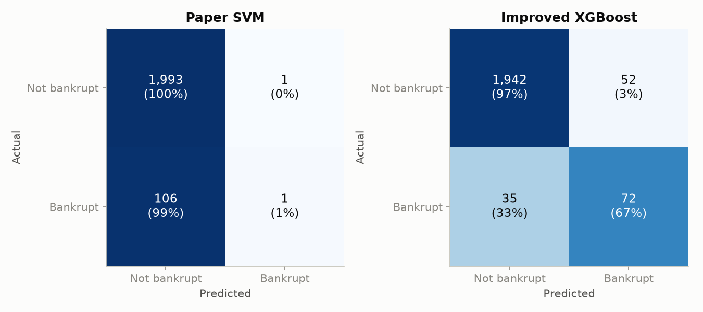
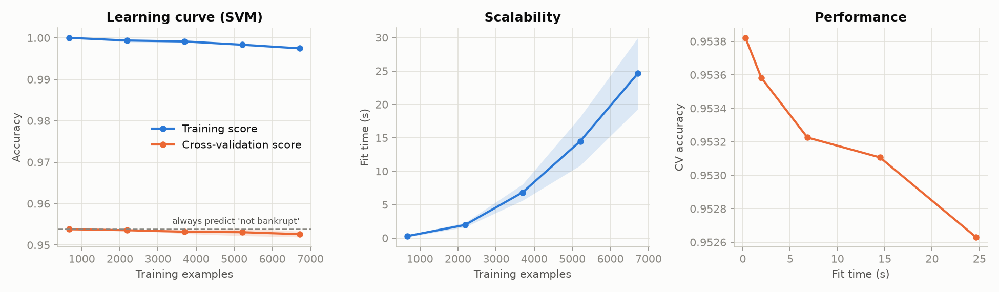
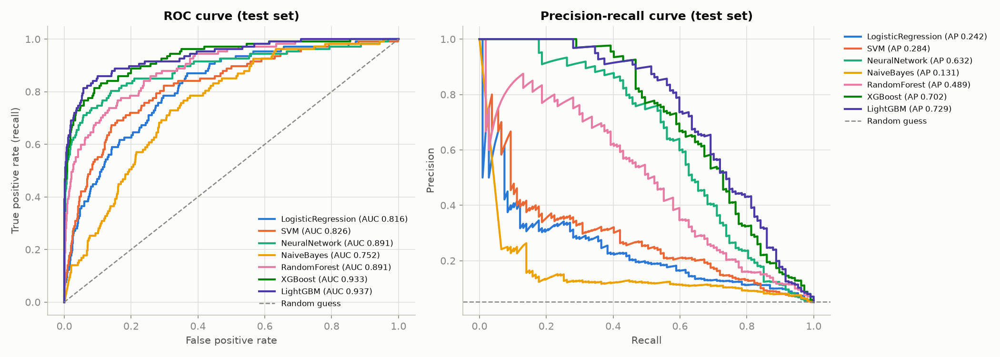

# Project Explained: Corporate Bankruptcy Prediction

A plain-language walkthrough of the whole project: what we did, why we did it, what we found, and
the concepts behind it. The technical summary and full result tables are in [README.md](README.md).

---

## 1. The project in one paragraph

We took a Stanford CS229 student project that predicts which companies will go bankrupt. We re-ran
it with the same data, models and settings, and got the same numbers. Then we showed that its main
result is misleading. The paper's best models score about 95% accuracy, but they get that score by
predicting **"not bankrupt" for every single company**. Only 5% of companies go bankrupt, so
guessing "no" every time is automatically 95% right. We then fixed the evaluation and the training
with a few simple, standard changes. Our best models (gradient-boosted trees) now catch
**up to 72 of the 107 bankrupt companies** in the test set. The paper's best model caught **1**.

---

## 2. The problem and the data

**Goal:** given a company's financial statements, predict whether it will go bankrupt within the
next 3 years. That is a **binary classification** problem: the answer is yes (1) or no (0).

**Dataset:** Polish Companies Bankruptcy data (UCI Machine Learning Repository).

| | |
|---|---|
| Companies (rows) | 10,503 |
| Features (columns) | 64 financial ratios, e.g. net profit / total assets, total liabilities / total assets |
| Bankrupt | 495 (**4.7%**) |
| Not bankrupt | 10,008 (95.3%) |
| Missing values | 53.5% of rows have at least one missing ratio |

The dataset has five files, one per forecasting horizon. Like the paper, we use the **"3rd year"
file**. It is the largest one, and its label is "bankrupt within 3 years".

**Split:** 80% training (8,402 companies), 20% test (2,101 companies, 107 of them bankrupt). The
model never sees the test set during training. It is used once, at the end, to measure performance.



---

## 3. What the original paper did

1. **Filled in missing values** with the column mean (mean imputation).
2. **Did not scale the features.** The author said scaling made results worse.
3. **Trained six models:** Logistic Regression, SVM, Neural Network, Naive Bayes, XGBoost and LightGBM.
4. **Measured accuracy and log loss**, using 5-fold cross-validation.
5. **Concluded** that SVM, Logistic Regression and the Neural Network were best (~94.7% accuracy),
   and that boosting was surprisingly bad (53% and 71%).

---

## 4. Step 1: Replication (`src/replicate.py`)

We re-implemented every step with the paper's settings. Our numbers match the paper closely:

| Model | Paper accuracy | Our accuracy | Bankrupt companies caught (ours) |
|---|---|---|---|
| Logistic Regression | 0.947 | 0.948 | 0 of 107 |
| SVM | 0.947 | 0.949 | 1 of 107 |
| Neural Network | 0.947 | 0.949 | 0 of 107 |
| Naive Bayes | 0.756 | 0.763 | 59 of 107 |
| XGBoost | 0.526 | 0.949 | 0 of 107 |
| LightGBM | 0.709 | 0.949 | 0 of 107 |
| **"Always say not bankrupt"** | **0.947** | **0.949** | **0 of 107** |

The small differences (for example 0.947 vs 0.949) come from the random train/test split. The
paper's test set happened to have 111 bankrupt companies; ours has 107.

**Replication succeeded for four of the six models.** The two boosting models are discussed below.

---

## 5. The big finding: the 95% accuracy is fake

Look at the last row of the table above. A "model" that ignores the data and always answers
"not bankrupt" scores **exactly the same accuracy** as the paper's best models. The paper even
printed the SVM's confusion matrix, `[[1990, 0], [111, 0]]`. That matrix says the SVM predicted
"not bankrupt" for all 2,101 test companies.

**An analogy:** a smoke detector that never goes off is "right" 99.9% of the time, because most
days there is no fire. It is still useless, because it misses every fire.

This is called the **accuracy paradox**. It happens whenever one class is much rarer than the other
(class imbalance). Here, the bankruptcies are exactly the cases we care about.



The confusion matrices make it obvious. On the left, the paper's SVM catches 1 bankruptcy. On the
right, our improved XGBoost catches 72.



The SVM learning curve (the paper's Figure 3a, which we recreated) tells the same story:
- **Training accuracy is ~100%:** the SVM memorises the training data.
- **Cross-validation accuracy stays on the "always say no" line**, no matter how much data it gets.
  It never learns anything useful. This is **overfitting**.



### Other problems we found while replicating

1. **The "log loss" isn't a real log loss.** Log loss should be computed from predicted
   *probabilities*. The paper's values only come out if you feed in hard 0/1 predictions. The result
   is just the error rate multiplied by a constant (34.54). We reproduced their numbers exactly this
   way, which shows that is what they did.
2. **The SVM's 100% training accuracy depends on an old default.** In 2019, scikit-learn's SVM
   used `gamma="auto"` by default. On unscaled data, that setting makes the SVM memorise every
   training point. We set it explicitly to match the paper.
3. **The boosting results could not be reproduced.** The paper reports 53% (XGBoost) and 71%
   (LightGBM). Both are *worse than always saying "no"* (95%). No reasonable settings we tried gave
   anything below 95%, and plain default LightGBM scored 97.3%. Those numbers were most likely a
   bug in the original code. The paper itself says boosting "needs further inspection".

---

## 6. Step 2: The improvements (`src/improved.py`)

We kept the same data, the same split and the same kinds of models. We made five simple changes,
each a standard technique taught in intro ML:

| # | Problem | Fix | Why it helps |
|---|---|---|---|
| 1 | Only 4.7% bankrupt, so models learn to always say "no" | **Class weighting** (`class_weight="balanced"`, `scale_pos_weight`) | Each mistake on a bankrupt company costs ~20× more during training, so the model can't ignore them. |
| 2 | Accuracy hides the failure | **Better metrics**: recall, precision, F1, ROC-AUC, PR-AUC | These metrics give "always say no" a score of 0 or 0.5, so they show whether the model actually learned. |
| 3 | Features are extremely skewed with huge outliers, and weren't scaled | **QuantileTransformer** (for LR, SVM, Neural Net, Naive Bayes) | Maps every feature to a bell-curve shape, so one outlier can't dominate. Tree models don't need this. |
| 4 | Mean imputation is distorted by outliers | **Median imputation**; boosted trees handle missing values on their own | The median isn't pulled around by extreme values. |
| 5 | The paper's "XGBoost" used a *linear* booster | **Real gradient-boosted trees**, plus a Random Forest | Trees are the standard choice for tabular data like financial ratios. |

**We did not tune any settings on the test set.** We chose all settings once, in advance. If we
had picked the settings that scored best on the test set, the test score would be biased upward.

### Results

| Model | ROC-AUC | Recall | Precision | F1 | Bankrupt caught |
|---|---|---|---|---|---|
| **LightGBM** | **0.937** | 0.56 | 0.83 | **0.67** | 60 / 107 |
| **XGBoost** | 0.933 | 0.67 | 0.58 | 0.62 | 72 / 107 |
| Neural Network | 0.891 | 0.52 | 0.76 | 0.62 | 56 / 107 |
| Random Forest | 0.891 | 0.07 | 0.78 | 0.12 | 7 / 107 |
| SVM | 0.826 | 0.61 | 0.21 | 0.31 | 65 / 107 |
| Logistic Regression | 0.816 | 0.72 | 0.13 | 0.22 | 77 / 107 |
| Naive Bayes | 0.752 | 0.68 | 0.11 | 0.20 | 73 / 107 |
| *Random guessing* | *0.500* | | | | |



### What the results mean

- **Boosted trees (LightGBM, XGBoost) are clearly the best.** That is the *opposite* of the paper's
  conclusion. It matches the original research on this dataset (Zięba et al., 2016). Trees work well
  here because they don't care about feature scale, aren't thrown off by outliers, and handle
  missing values natively.
- **Logistic Regression catches the most bankruptcies (77) but raises many false alarms.** Only 13%
  of the companies it flags actually go bankrupt. Its high recall comes with very low precision.
- **The Random Forest ranks companies well (AUC 0.89) but almost never says "bankrupt".** Its
  default 0.5 cutoff is too strict for rare events. Lowering the cutoff would catch more.
- **Which model is "best" depends on the cost of each mistake.** A bank that wants to avoid lending
  to companies that will fail might prefer XGBoost (higher recall). One that wants few false alarms
  might prefer LightGBM (higher precision).

---

## 7. Key concepts (cheat sheet)

### Models

| Model | One-line explanation |
|---|---|
| **Logistic Regression** | A linear model that turns a weighted sum of the features into a probability using the sigmoid function. |
| **SVM** (Support Vector Machine) | Finds the boundary between classes with the widest margin. The RBF kernel allows curved boundaries. |
| **Neural Network** (MLP) | Layers of simple units that learn non-linear patterns. Trained by backpropagation. |
| **Naive Bayes** | Uses Bayes' theorem and assumes all features are independent given the class. Simple and fast, but that assumption is rarely true. |
| **Random Forest** | Many decision trees, each trained on a random sample of the data. They vote. |
| **Gradient Boosting** (XGBoost, LightGBM) | Builds trees one after another, where each new tree fixes the mistakes of the previous ones. |

### Metrics

Think of "positive" as "bankrupt".

| Metric | Question it answers | "Always say no" scores |
|---|---|---|
| **Accuracy** | What fraction of all predictions were right? | 0.95 (misleading) |
| **Recall** | Of the companies that actually went bankrupt, how many did we catch? | 0 |
| **Precision** | Of the companies we flagged, how many actually went bankrupt? | undefined / 0 |
| **F1 score** | A single score that is high only when precision *and* recall are both high (their harmonic mean). | 0 |
| **ROC-AUC** | If we pick one bankrupt and one healthy company at random, how often does the model rank the bankrupt one as riskier? 1.0 is perfect, 0.5 is random. | 0.5 |
| **PR-AUC** | The area under the precision-recall curve. It is stricter than ROC-AUC when positives are rare. Random guessing scores about 0.05 here. | ~0.05 |
| **Confusion matrix** | A 2×2 table of true negatives, false positives, false negatives and true positives. | |

### Other terms

- **Class imbalance:** one class is much rarer than the other (here 95% vs 5%).
- **Cross-validation (5-fold):** split the training data into 5 parts, train on 4 and test on 1,
  then rotate through all 5. This gives a more reliable estimate than a single split.
  *Stratified* means each fold keeps the same 95/5 ratio.
- **Imputation:** filling in missing values, here with the mean (paper) or median (ours).
- **Overfitting:** the model memorises the training data (high training score) but fails on new
  data (low test score).
- **Regularisation (L2):** a penalty on large model weights that discourages overfitting.
- **Class weighting:** making mistakes on the rare class cost more during training.
- **Feature scaling / QuantileTransformer:** putting all features on a comparable scale. The
  quantile transform also removes the effect of outliers.

---

## 8. How the code is organised

| File | What it does |
|---|---|
| `src/data.py` | Downloads the dataset, loads it, and makes the 80/20 split (fixed random seed, so results are reproducible). |
| `src/replicate.py` | The paper's six models with the paper's settings. Produces `results/replication.csv`. |
| `src/improved.py` | Our improved pipeline. Produces `results/improved.csv`. |
| `src/plots.py` | All five figures in `results/figures/`. |

To run it:

```bash
pip install -r requirements.txt
cd src
python data.py
python replicate.py
python improved.py
python plots.py          # add --fast to skip the 10-minute SVM learning curve
```

All random seeds are fixed, so re-running gives the same numbers.

---

## 9. Questions your teacher might ask

**Q: Did you successfully replicate the paper?**
Yes, for Logistic Regression, SVM, the Neural Network and Naive Bayes. Our accuracies are within
0.2–0.7 percentage points of the paper's. Even the SVM's 100% training accuracy reproduces. The
boosting results did not reproduce, and we explain why we think they were a bug (Section 5).

**Q: Why is 95% accuracy bad?**
Because 95% of companies don't go bankrupt. A model that always says "no" gets 95% for free and
never catches a single bankruptcy. The paper's models were doing exactly that.

**Q: Why didn't you just oversample the bankrupt companies (e.g. SMOTE)?**
Class weighting has the same goal: making the rare class matter more. It is one line of code, and
it doesn't create synthetic data. SMOTE would be a reasonable next step to try.

**Q: Why are tree models better than SVM or Logistic Regression here?**
Financial ratios are very skewed, have extreme outliers, and are often missing. Trees split on
thresholds ("is this ratio above X?"), so the scale and outliers don't matter. XGBoost and LightGBM
also handle missing values on their own.

**Q: Why didn't you scale the features, like the paper?**
We did, for the models that need it (LR, SVM, Neural Net, Naive Bayes). The paper said scaling hurt,
but standard scaling breaks down on data with huge outliers. A quantile transform handles that.
Tree models don't need scaling at all.

**Q: Isn't 0.56 recall still low?**
It means LightGBM catches about half the bankruptcies while being right 83% of the time it raises a
flag. Lowering the decision threshold below 0.5 would raise recall at the cost of more false alarms.
The precision-recall curve shows that whole trade-off. Which point to pick depends on how costly a
missed bankruptcy is compared to a false alarm.

**Q: How do you know you didn't overfit to the test set?**
We chose all settings in advance and never adjusted them based on test results. We also report
cross-validation ROC-AUC on the training set. It agrees with the test numbers (0.915 vs 0.937 for
LightGBM).

**Q: Why ROC-AUC *and* PR-AUC?**
ROC-AUC can look optimistic when positives are rare, because there are so many true negatives.
PR-AUC focuses only on how well we find the bankrupt companies. Random guessing gets 0.05 PR-AUC
here; LightGBM gets 0.73.

---

## 10. Limitations and next steps

- **One forecasting horizon.** We used only the 3rd-year file. The same code could run on years 1–5.
- **One random split.** A different split gives slightly different numbers. Repeating with several
  seeds would give error bars.
- **Default decision threshold (0.5).** Choosing the threshold with cross-validation would balance
  precision and recall better.
- **No hyperparameter tuning.** A grid search with cross-validation (never on the test set) would
  likely improve every model a little.
- **Feature engineering.** The original dataset paper (Zięba et al., 2016) added synthetic features
  and reported even higher AUC with boosted trees.

---

## References

1. N. A. Patil, *Corporate Bankruptcy Prediction*, CS229 project, Stanford University, Fall 2019.
2. M. Zięba, S. Tomczak, J. Tomczak, *Ensemble boosted trees with synthetic features generation in
   application to bankruptcy prediction*, Expert Systems with Applications 58, 2016.
3. Polish Companies Bankruptcy Data, UCI Machine Learning Repository, dataset #365.
